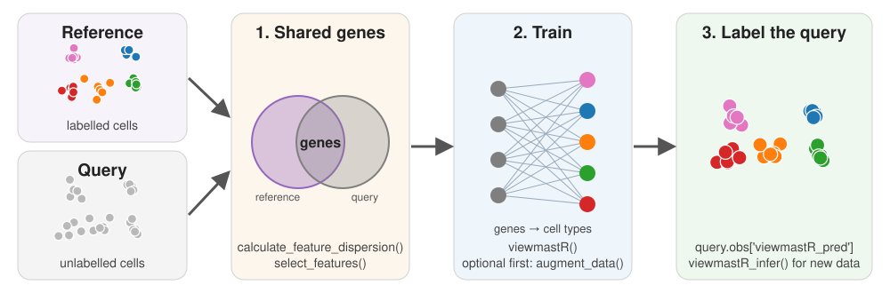

# py-viewmastR

**Cell-type label transfer for single-cell RNA-seq, in Python.**

py-viewmastR is a Python port of the R package [viewmastR](https://github.com/furlan-lab/viewmastR).
It learns cell types from a labelled reference dataset and predicts them for a query dataset.
Training runs in viewmastR's Rust code ([burn](https://burn.dev)), compiled as a Python extension.

Documentation: <https://jacob-greene.github.io/py-viewmastR/>. To build from source and run the
tests, see [development](docs/development.md).

## Installation

The install builds a small Rust extension, so it needs a Rust toolchain (1.86 or newer, from
[rustup](https://rustup.rs)).

```bash
uv pip install "git+https://github.com/jacob-greene/py-viewmastR"
# or, from a clone:
uv pip install .            # add ".[tutorials]" for scanpy and Jupyter
```

## Quick start

```python
import anndata as ad
import viewmastr as vm

ref = ad.read_h5ad("reference.h5ad")   # raw counts in .X, labels in .obs["celltype"]
query = ad.read_h5ad("query.h5ad")     # raw counts in .X

# Train on genes that vary in both datasets
for a in (ref, query):
    vm.calculate_feature_dispersion(a)
    vm.select_features(a, top_n=10_000, logmean_ul=-1, logmean_ll=-8)
genes = set(vm.get_selected_features(ref))
vg = [g for g in vm.get_selected_features(query) if g in genes]

vm.viewmastR(query, ref, "celltype", selected_features=vg, return_probs=True)
query.obs["viewmastR_pred"]            # predicted cell type
```

## How it works



## Example: Cell type refinement using the bone marrow map reference atlas


viewmastR learned the 55 BoneMarrowMap cell types and labelled a T-cell-depleted bone marrow
dataset (8,627 cells, 18 author labels).
(**a**) Reference. (**b**) Query, authors' labels. (**c**) Query, viewmastR labels.
(**d**) Fraction of each author label (column) given each predicted type (row).
In (**b**) and (**c**), the ring marks the authors' `Mega` cluster (24 cells).
viewmastR labels all of them EoBasoMast Precursor (EBMP).
[`scripts/readme_figures.py`](scripts/readme_figures.py) makes the figure.

## Citation

If you use py-viewmastR, please cite the viewmastR R package:

- Furlan SN. viewmastR: cell-type classification for single-cell genomics.
  https://github.com/furlan-lab/viewmastR
- Greene J, Furlan SN. py-viewmastR. https://github.com/jacob-greene/py-viewmastR

## Authors

Jacob Greene and Scott Furlan.

## License

MIT. The Rust code in `rust/src/` is adapted from viewmastR (MIT, Copyright 2026 Scott N
Furlan); see [LICENSE](LICENSE).
