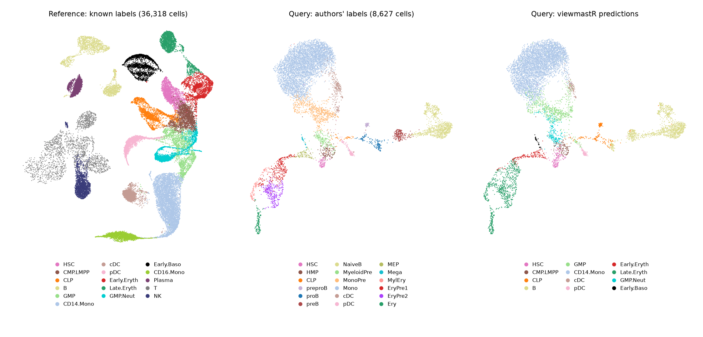
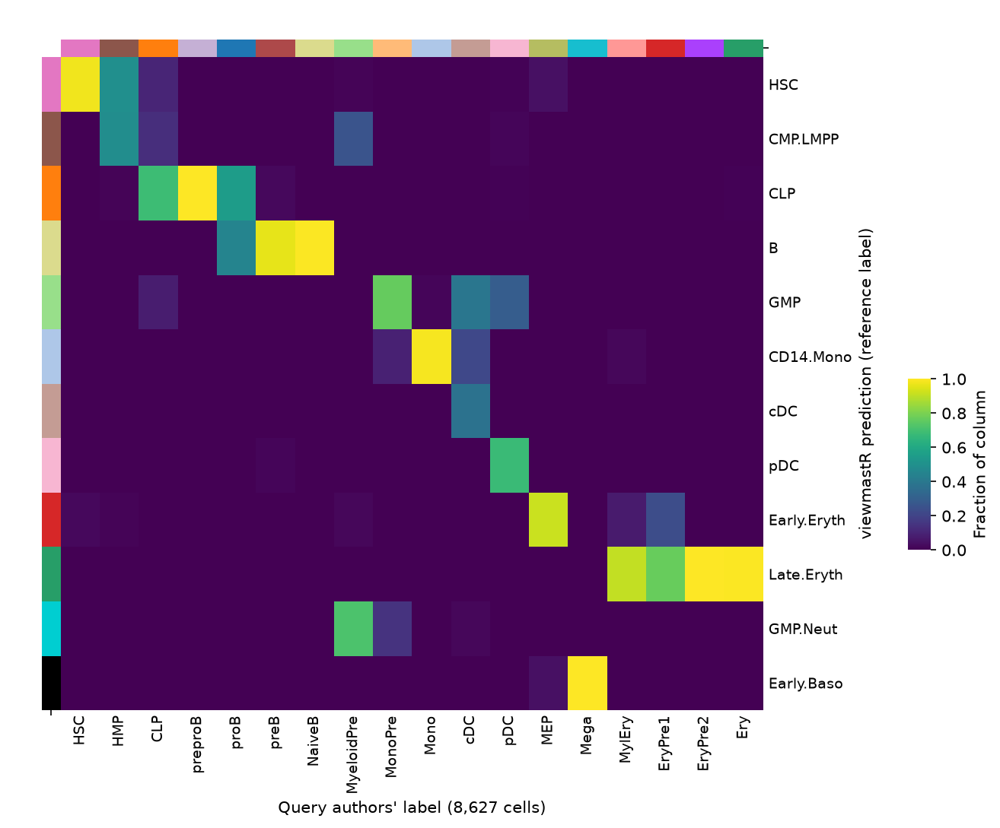

# py-viewmastR

**Cell-type label transfer for single-cell RNA-seq, in Python.**

py-viewmastR is a Python port of [viewmastR](https://github.com/furlan-lab/viewmastR), the
Furlan lab's R package. It learns cell types from a labelled reference dataset and predicts
them for a query dataset. Models train in viewmastR's own Rust code (the
[burn](https://burn.dev) deep-learning framework), compiled as a Python extension.

- Works on [AnnData](https://anndata.readthedocs.io), including on-disk (backed) objects of
  millions of cells.
- Mirrors the R API: `viewmastR()`, `viewmastR_infer()`, feature selection, bulk references,
  class augmentation and bulk deconvolution.
- Reads and writes R viewmastR model files. A Python model and an R model trained on the
  same cells agree as closely as two R runs do ([details](docs/r_comparison.md)).

## Example

A model trained on a healthy bone marrow atlas (left) labels a separate bone marrow dataset.
The query is shown on its own published UMAP, coloured by its authors' labels (middle) and by
the viewmastR prediction (right). Colours are those of `viewmastr.palette`.



The query authors labelled these cells independently, with their own names. Each column is
one author label; colour is the fraction of its cells that get each predicted label. The two
vocabularies differ, so read it as a mapping between them, not as an accuracy.



| Item | Value |
|---|---|
| Reference | Granja et al. 2019 bone marrow atlas, 36,318 cells, 16 cell types |
| Query | Persad et al. 2023 T-cell-depleted bone marrow multiome RNA, 8,627 cells, stored UMAP |
| Model | default multinomial logistic regression, 5 epochs |
| Accuracy on held-out reference cells | 95.5 % (7,264 cells) |

[`scripts/readme_figures.py`](scripts/readme_figures.py) makes both figures.

## Installation

py-viewmastR builds a small Rust extension, so it needs a Rust toolchain (1.86 or newer,
from [rustup](https://rustup.rs)).

```bash
uv pip install "git+https://github.com/jacob-greene/py-viewmastR"
# or, from a clone:
uv pip install .            # add ".[tutorials]" for scanpy and Jupyter
```

## Quick start

```python
import anndata as ad
import viewmastr as vm

ref = ad.read_h5ad("reference.h5ad")   # raw counts in .X, labels in .obs["celltype"]
query = ad.read_h5ad("query.h5ad")     # raw counts in .X

# Train on genes that vary in both datasets
for a in (ref, query):
    vm.calculate_feature_dispersion(a)
    vm.select_features(a, top_n=10_000, logmean_ul=-1, logmean_ll=-8)
genes = set(vm.get_selected_features(ref))
vg = [g for g in vm.get_selected_features(query) if g in genes]

vm.viewmastR(query, ref, "celltype", selected_features=vg, return_probs=True)
query.obs["viewmastR_pred"]            # predicted cell type
```

## Documentation

| Topic | Where |
|---|---|
| Tutorials, one per article on the [viewmastR website](https://furlan-lab.github.io/viewmastR/) | [`tutorials/`](tutorials/README.md) |
| Function list, agreement with R, and differences from R | [`docs/r_comparison.md`](docs/r_comparison.md) |
| Building from source and running the tests | [`docs/development.md`](docs/development.md) |

## Citation

If you use py-viewmastR, please cite the viewmastR R package and the datasets you use:

- Furlan SN. viewmastR: cell-type classification for single-cell genomics.
  https://github.com/furlan-lab/viewmastR
- Greene J, Furlan SN. py-viewmastR. https://github.com/jacob-greene/py-viewmastR

The example above uses these public datasets:

- Granja JM, Klemm S, McGinnis LM, et al. Single-cell multiomic analysis identifies
  regulatory programs in mixed-phenotype acute leukemia. *Nat Biotechnol* 37, 1458-1465
  (2019). GEO GSE139369.
- Persad S, Choo ZN, Dien C, et al. SEACells infers transcriptional and epigenomic cellular
  states from single-cell genomics data. *Nat Biotechnol* 41, 1746-1757 (2023). Zenodo
  record 6383269.
  The processed object with UMAP is the file the [Mellon](https://github.com/settylab/Mellon)
  tutorial downloads (Otto DJ, et al. *Nat Methods* 2024).

## Authors

Jacob Greene and Scott Furlan.

## License

MIT. The Rust code in `rust/src/` is adapted from viewmastR (MIT, Copyright 2026 Scott N
Furlan); see [LICENSE](LICENSE).
