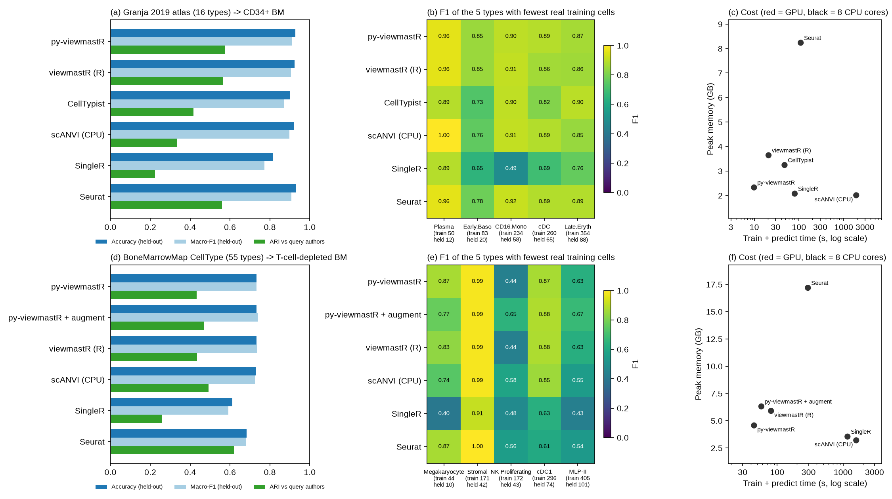

# Benchmark against other label-transfer tools

This page compares py-viewmastR with five other label-transfer tools. Every tool gets the same cells, the same genes and the same labels. The code is in `benchmarks/` in this repository.

## Terms

| Term | Meaning |
|---|---|
| Held-out cells | Reference cells kept out of training and used to score accuracy |
| Accuracy | Share of held-out cells that get their true label |
| Macro-F1 | F1 score per cell type, averaged over types with equal weight. Rare types count as much as common types |
| ARI, NMI | Adjusted Rand index and normalised mutual information. Each one scores how well the predicted query labels agree with the authors' query labels, with no label mapping (1 = the same partition). They are not accuracy, because the query authors used different type names |
| Simulated cells | Cells in the Greenleaf reference file, named `stimcell_*`, that top each type up to 2,000 cells |

## Tasks

| Task | Reference (training) | Held-out cells | Query | Genes |
|---|---|---|---|---|
| `greenleaf` | Granja et al. 2019 atlas (GEO GSE139369), 16 types: 80 % of the real cells of each type plus all 14,464 simulated cells (31,954 cells) | the other 20 % of the real cells (4,364 cells) | CD34+ bone marrow multiome RNA, Persad et al. 2023 (Zenodo 6383269), 6,881 cells | 5,972 |
| `bmm` | BoneMarrowMap (Zeng et al. 2025), `CellType` with 55 types: the cells that are not held out (118,509 cells) | 20 % of each type, at most 1,000 per type (35,575 cells); the README uses the same split | T-cell-depleted bone marrow, Persad et al. 2023 (Zenodo 6383269), 8,627 cells | 3,867 |

The genes are the variable genes shared by the reference and the query, picked as in [How to use viewmastR](tutorials/01_how_to.ipynb). Every tool gets raw counts on these genes and normalises them its own way.

On `greenleaf`, only real cells are held out. The simulated cells are copies built from real cells. If they were in the held-out set, a tool would score well by memorising them.

## Tools

| Tool | Version | Normalisation | Method |
|---|---|---|---|
| py-viewmastR | 0.1.0 | its own (log) | multinomial logistic regression, 5 epochs (the default) |
| py-viewmastR + augment | 0.1.0 | its own (log) | the same, trained on a reference balanced with `augment_data()` (`bmm` only) |
| viewmastR (R) | 0.5.0 | its own (log) | multinomial logistic regression, 5 epochs |
| CellTypist | 1.7.1 | counts per 10,000, log1p | logistic regression, `feature_selection=False` (the genes are fixed), no majority voting |
| scANVI (scvi-tools) | 1.5.2 | none (raw counts) | scVI, then scANVI from it, default epochs; predicts new cells without retraining |
| SingleR | 2.6.0 | counts per 10,000, log1p | `de.method = "wilcox"`, as advised for single-cell references |
| Seurat | 5.1.0 | `LogNormalize` | PCA (30 dimensions), `FindTransferAnchors` and `TransferData` |

All settings are each tool's documented defaults, except where the table says otherwise. Every run used 8 CPU cores on one Slurm node.

## Results



*(a, d) Accuracy and macro-F1 on held-out reference cells, and ARI against the query authors' labels. (b, e) F1 of the 5 types with the fewest real training cells; under each type, the number of real training cells and held-out cells. (c, f) Train plus predict time against peak memory. Black points ran on 8 CPU cores; red points ran on a GPU.*

### Metrics

#### `greenleaf`

| Tool | Device | Accuracy | Macro-F1 | ARI | NMI | Train (s) | Predict (s) | Peak memory (GB) |
|---|---|---|---|---|---|---|---|---|
| py-viewmastR | CPU | 0.928 | 0.910 | 0.576 | 0.614 | 9.4 | 0.5 | 2.3 |
| viewmastR (R) | CPU | 0.925 | 0.906 | 0.566 | 0.610 | 18.2 | 2.6 | 3.6 |
| CellTypist | CPU | 0.899 | 0.871 | 0.417 | 0.455 | 45.7 | 1.9 | 3.2 |
| scANVI (CPU) | CPU | 0.919 | 0.897 | 0.333 | 0.438 | 1,908.2 | 0.3 | 2.0 |
| SingleR | CPU | 0.816 | 0.773 | 0.223 | 0.312 | 10.7 | 69.4 | 2.1 |
| Seurat | CPU | 0.929 | 0.908 | 0.559 | 0.606 | 56.3 | 52.9 | 8.2 |

#### `bmm`

| Tool | Device | Accuracy | Macro-F1 | ARI | NMI | Train (s) | Predict (s) | Peak memory (GB) |
|---|---|---|---|---|---|---|---|---|
| py-viewmastR | CPU | 0.732 | 0.732 | 0.433 | 0.693 | 44.1 | 0.5 | 4.6 |
| py-viewmastR + augment | CPU | 0.732 | 0.738 | 0.470 | 0.699 | 57.1 | 0.5 | 6.3 |
| viewmastR (R) | CPU | 0.734 | 0.734 | 0.434 | 0.696 | 74.8 | 6.0 | 5.9 |
| scANVI (CPU) | CPU | 0.729 | 0.726 | 0.492 | 0.660 | 1,580.7 | 0.6 | 3.2 |
| SingleR | CPU | 0.611 | 0.591 | 0.260 | 0.515 | 46.6 | 1,119.8 | 3.5 |
| Seurat | CPU | 0.683 | 0.678 | 0.622 | 0.710 | 87.6 | 204.8 | 17.2 |

### Rare types

Each column header gives the number of real training cells / held-out cells.

#### `greenleaf`: F1 of the 5 types with fewest real training cells

| Tool | Plasma (50 / 12) | Early.Baso (83 / 20) | CD16.Mono (234 / 58) | cDC (260 / 65) | Late.Eryth (354 / 88) |
|---|---|---|---|---|---|
| py-viewmastR | 0.96 | 0.85 | 0.90 | 0.89 | 0.87 |
| viewmastR (R) | 0.96 | 0.85 | 0.91 | 0.86 | 0.86 |
| CellTypist | 0.89 | 0.73 | 0.90 | 0.82 | 0.90 |
| scANVI (CPU) | 1.00 | 0.76 | 0.91 | 0.89 | 0.85 |
| SingleR | 0.89 | 0.65 | 0.49 | 0.69 | 0.76 |
| Seurat | 0.96 | 0.78 | 0.92 | 0.89 | 0.89 |

#### `bmm`: F1 of the 5 types with fewest real training cells

| Tool | Megakaryocyte (44 / 10) | Stromal (171 / 42) | NK Proliferating (172 / 43) | cDC1 (296 / 74) | MLP-II (405 / 101) |
|---|---|---|---|---|---|
| py-viewmastR | 0.87 | 0.99 | 0.44 | 0.87 | 0.63 |
| py-viewmastR + augment | 0.77 | 0.99 | 0.65 | 0.88 | 0.67 |
| viewmastR (R) | 0.83 | 0.99 | 0.44 | 0.88 | 0.63 |
| scANVI (CPU) | 0.74 | 0.99 | 0.58 | 0.85 | 0.55 |
| SingleR | 0.40 | 0.91 | 0.48 | 0.63 | 0.43 |
| Seurat | 0.87 | 1.00 | 0.56 | 0.61 | 0.54 |

### Runs not in these results

| Run | Status |
|---|---|
| CellTypist on `bmm` | Still running with default settings (no SGD) after more than 3 hours on 8 cores. Its row will be added when it ends, or reported as not finished in 12 hours |
| scANVI on a GPU (both tasks) | Queued; the shared GPU partition had not started the jobs after several hours. The scANVI rows above ran on 8 CPU cores, so their times are not GPU times |


## How to read these results

- Accuracy and macro-F1 come from one random 80/20 split per task. The spread across splits was not measured, so do not read much into differences under about 0.01.
- ARI and NMI compare two different label sets. A higher value means the predicted query partition is closer to the authors' partition. It does not mean the labels are correct.
- F1 for a rare type rests on few held-out cells (10 to 101 cells). With 10 held-out cells, one cell more or less correct moves F1 by up to about 0.1.
- Train and predict times exclude data loading. Peak memory includes data loading.
- Seurat and SingleR do most of their work at prediction time, once per query. Their predict times grow with each new query.
- viewmastR training uses several data-loader workers by default, so two runs are not bit-identical (see [Comparison with R](r_comparison.md)).

## Reproduce

```bash
export BENCH_DIR=/path/to/bench
PYTHONPATH=tutorials python benchmarks/prepare.py greenleaf      # and again with bmm
python benchmarks/run_python.py viewmastr $BENCH_DIR/greenleaf --threads 8
Rscript benchmarks/run_r.R seurat $BENCH_DIR/greenleaf 8
python benchmarks/summarize.py greenleaf bmm                    # scores, tables and the figure
```

`prepare.py` lists the source file of each dataset. `summarize.py` skips any tool with no prediction file.
